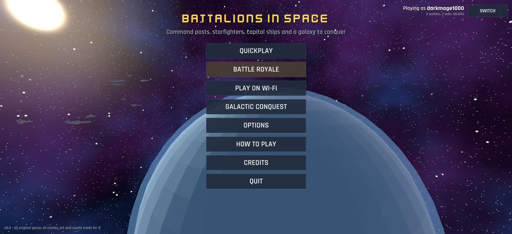
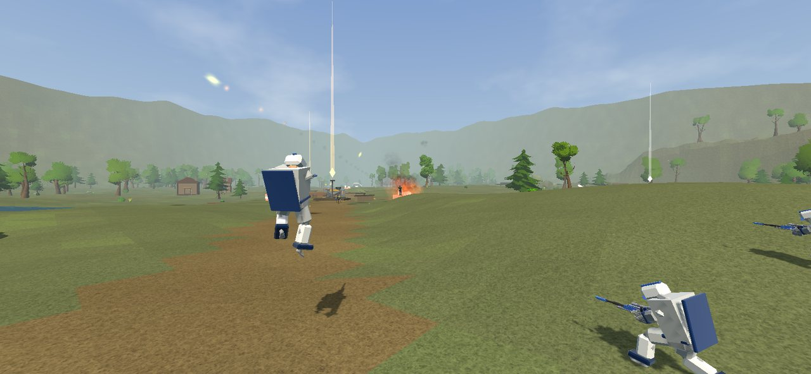
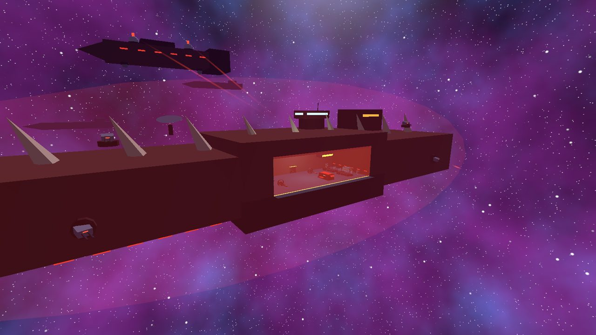
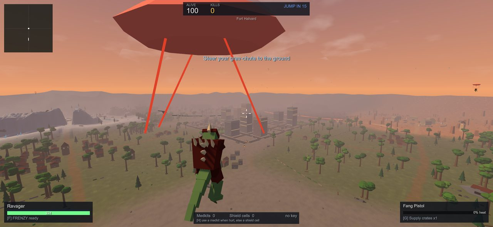
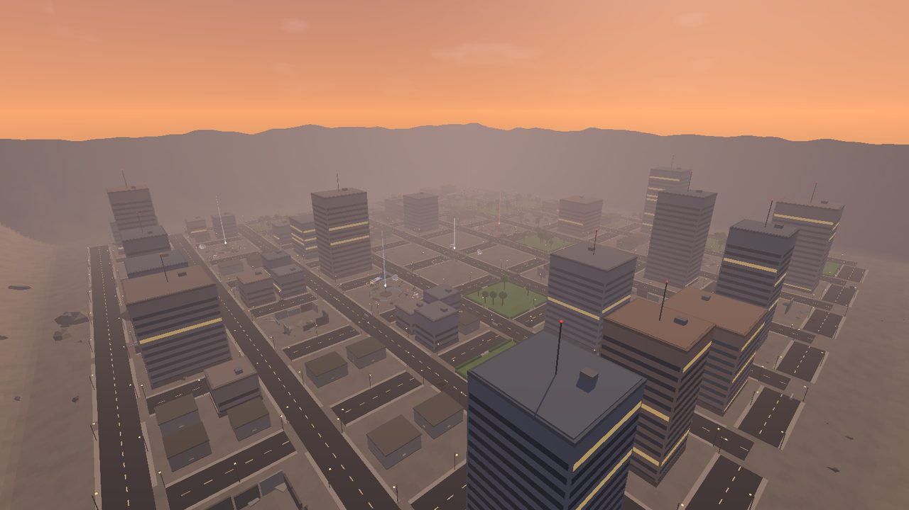
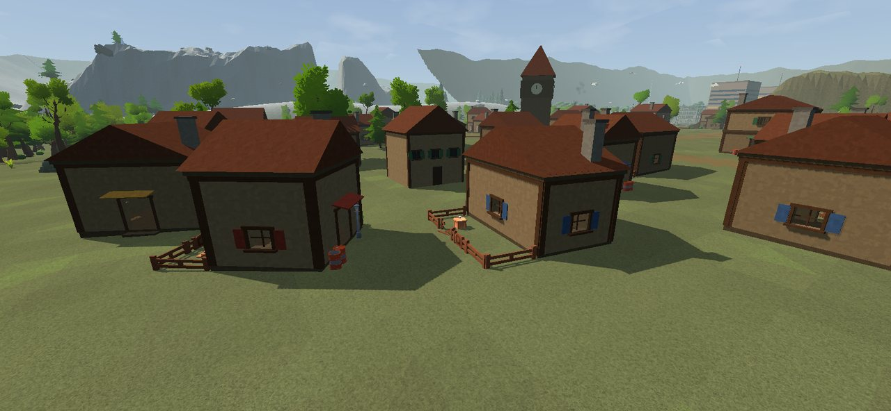
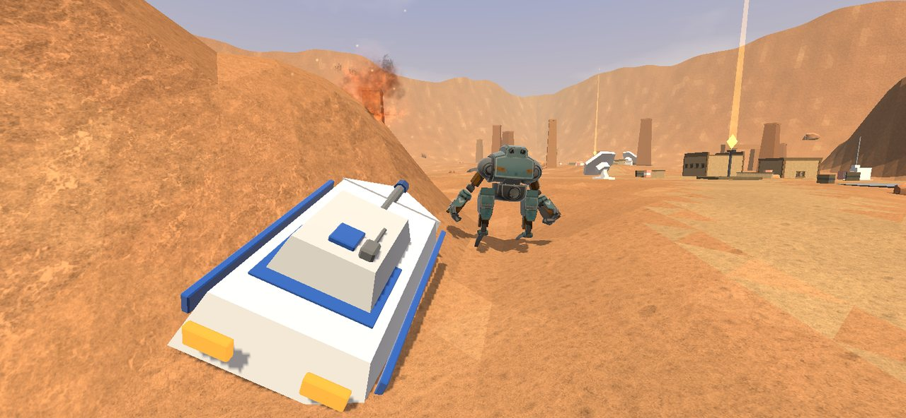
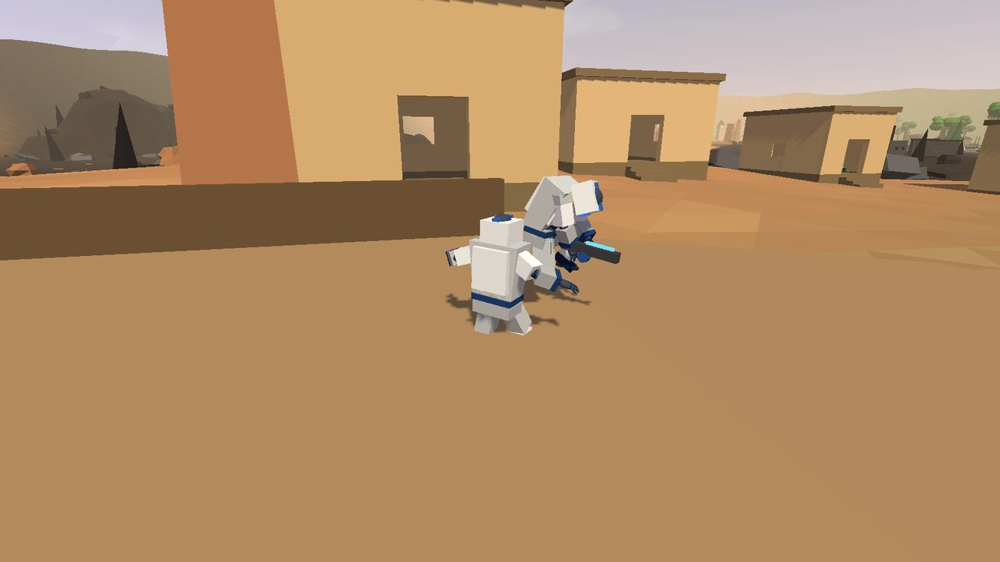
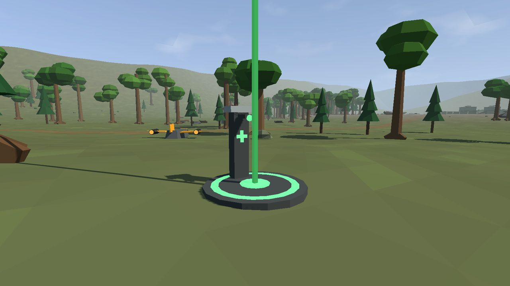
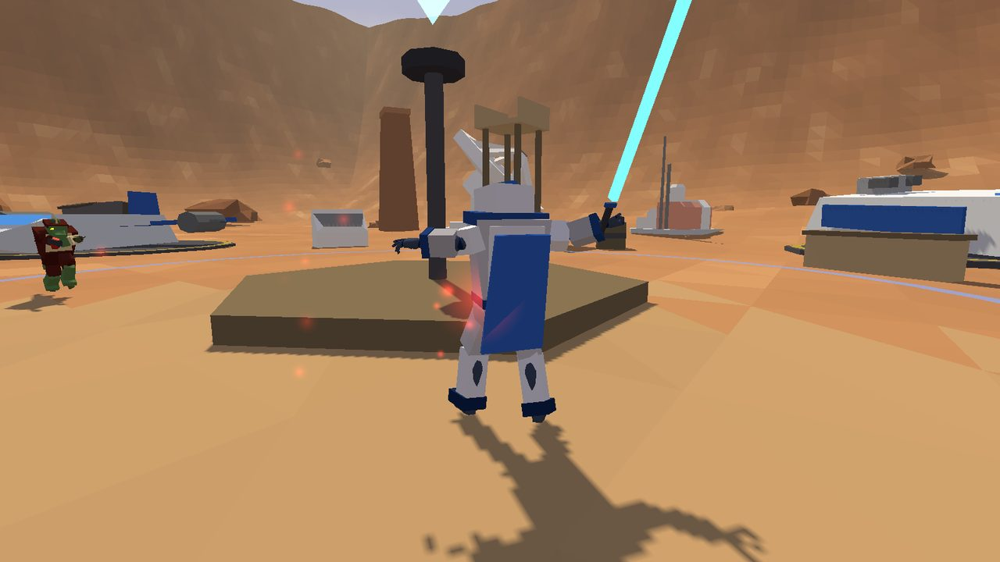

# Battalions in Space

**A large-scale sci-fi team shooter for Windows and Android.** Four original factions fight over command posts on open battlefields, dogfight between capital ships and board them through the hangar, drop into a 100-player battle royale (solo or in pairs), and wage a turn-based galactic campaign. Two people can play together over Wi-Fi.

**[Download v0.10](https://github.com/darkmage1000/Battalions-in-space/releases/latest)**: Android APK and Windows zip.



| | |
|---|---|
|  |  |
| *Land battle: a squad advances under fire* | *Space: a capital ship, its shield up and hangar open* |
|  |  |
| *Battle royale: gliding down from the dropship* | *Novo Meridian, the city map* |
|  |  |
| *A battle royale village* | *The Synod walking mech and a Concord hover tank* |

Made in Unity 6 (6000.0.62f1). Everything (factions, characters, ships, planets, story) is original; see [CREDITS.md](CREDITS.md) for the free sounds, music, models, textures and fonts used (all CC0 except one font under the SIL Open Font Licence).

---

## Contents
- [Game modes](#game-modes)
- [Battle royale](#battle-royale)
- [Factions](#factions)
- [Maps](#maps)
- [How fighting works](#how-fighting-works)
- [Controls](#controls)
- [Options](#options)
- [Getting the game](#getting-the-game)
- [For developers](#for-developers)

---

## Game modes

| Mode | What it is |
|---|---|
| **Quickplay** | One battle, land or space. Pick the map, your faction and the enemy's, tickets, bots per side and bot skill. |
| **Battle royale** | Up to 100 players on one huge map, **solos or duos**. Land with a sidearm, loot, outlast the zone. [Details below.](#battle-royale) |
| **Play on Wi-Fi** | Two phones or PCs on the same network: host a Quickplay battle or a battle royale and play **together** (same team / same duo) or **against** each other. The other device finds the game by itself, or you type the host's address. |
| **Galactic Conquest** | A turn-based campaign over 12 worlds. Move one fleet a turn along the hyperlanes; fleet against fleet is a space battle, invading a world is a land battle. Worlds pay credits: buy fleets, unlock classes and buy battle bonuses. Fight a battle yourself or auto-resolve it. Saves after every action. |

Each player has a local **account** (name and lifetime stats: battles, wins, kills); switch accounts from the main menu.

### Land battles
- Both sides start with reinforcement **tickets**; every soldier lost costs one. Stand in a **command post**'s ring with no enemies to neutralise it, then capture it. Holding more posts than the enemy bleeds their tickets. A side loses at 0 tickets, or when it can't hold a single post.
- Posts are spawn points (wait about 10 s after dying), and the bigger ones spawn **tanks, transports and gunships**. Spawn on a squad mate in the field if it's safe.
- Bots fight in **squads** with orders (attack a post, defend, flank), take buildings and climb towers.

### Space battles
- Launch from your capital ship's hangar in a **fighter, bomber, interceptor, support craft or boarding shuttle**.
- Knock out the enemy's **shield projectors**, then wreck its engines, turrets, bridge, sensors and hangar control.
- Or **board**: fly into the enemy hangar, slow down, press E to land, and sabotage **Life Support** and the **Reactor** on foot. Destroying them takes a big share of the ship's hull.
- Win on tickets, by destroying the hull, or by knocking out every critical system.

---

## Battle royale

**Kharos Frontier** is one 1.6 km world built from every land in the game: snowfields, forest, desert, a village, a city, lava, a military base, farms and a spaceport, in nine named regions.

- **The drop.** Tap the map to pick where you land, then jump. Every bot leaves the dropship when you do. You glide down under a grav-chute and steer with the move stick.
- **Loot** comes in five rarities: grey, green, blue, purple and gold, each stronger than the last. Picking up a gun tells you what it is, its range and its damage (e.g. *Assault rifle - medium range - 26 dmg - 5 shots/s*). There are also medkits, shield cells (armour), ammo and equipment packs.
- **Supply chests** (blue) hold better loot. **Eight vaults**, one per region, open only with a **vault key**: one in ten gold finds comes with one, and every match has at least one key per vault.
- **The zone** shrinks in six phases and can end anywhere, even in a corner. Outside it you lose health, faster each phase.
- **The Dreadnought Warlord**, a giant boss, lands a few minutes in. Kill it for gold loot.
- **Classes on or off.** With classes on you keep your class's health, speed, ability and equipment; weapons are always found.
- **High ground**: multi-storey buildings and open towers you can climb (bots use them too).



### Duos
- Teams of two: bots come in pairs, and you get a bot partner, or your Wi-Fi friend.
- **Jump leader**: the leader picks where the team lands and jumps; the partner jumps with them and their chute keeps alongside until they move the stick to split off.
- **Down, not out**: a hit that would kill you while your mate is standing knocks you down instead. You crawl, can't shoot, and bleed out over 30 seconds (enemies can finish you sooner). Your mate kneels beside you and holds **USE** for 5 seconds to bring you back. If nobody on a team is standing, the team is out.
- **ID tags and revive stations**: a mate who is finished off drops an **ID tag**. Pick it up and carry it to a **revive station** (green beam, marked on the map; each works once) to call them back in by grav-chute.
- **Share supplies**: DROP MEDKIT / DROP SHIELD / DROP GUN buttons put things on the ground for your mate.
- Bot partners revive you once a fight is won, fetch your tag and take it to a station, and stay close.



---

## Factions

Each faction has 5 classes (plus a pilot and a marine for space), 4 heroes, its own vehicles and starships.

| | Classes | Heroes | Vehicles | Starships |
|---|---|---|---|---|
| **Terran Concord** (humans) | Rifleman, Breacher, Longshot, Field Engineer, Vanguard (jump-pack) | Elena Voss, Darius Rook, Ilya Mareth, Sena Kai | Bastion tank, Mule APC, Kestrel gunship | Lancer, Hammerhead, Swiftwing, Aegis |
| **Vorrkai Dominion** (reptilian) | Clawguard, Siegebreaker, Fang Stalker, Forgeling, Ravager (frenzy) | Warlord Skarr, Huntmistress Vyssa, Bladefang Ruuk, Shaman Ossk | Crusher tank, Drake Carrier, Wyrm gunship | Talon, Maw, Viper, Brood Tender |
| **Iron Synod** (machines) | Unit-K Trooper, Breaker Frame, Optic Sentinel, Fabricator, Phantom Frame (cloak) | Prime Axiom, Executor Vex-9, Shard Duelist, The Choir | Monolith walker (a mech), Hive Hauler, Wasp gunship | Spindle, Anvil, Needle, Mender |
| **Kessari Veil** (psionic) | Veil Warden, Lancebearer, Seer, Weaver, Shade (rally) | Matriarch Ysolde, Duelist Kaeth, Starcaller Iru, Ironveil Thane | Pillar tank, Reliquary skiff, Heron gunship | Glaive, Bloom, Mote, Lantern |

**Class roles:**
- **Assault**: rifle and grenades.
- **Heavy**: rocket launcher that locks on to vehicles, plus mines.
- **Marksman**: sniper rifle.
- **Engineer**: shotgun, repair tool and detpacks.
- **Specialist**: carbine, a special (jump-pack, frenzy, cloak or rally) and supply crates.

**Hero types:**
- **Bladesworn**: a three-hit sword combo that ends in a spin, a dash strike, and blocking that deflects bolts.
- **Gunslinger**: fan fire.
- **Juggernaut**: heavy cannon.
- **Mystic**: beam.



---

## Maps

**Land (Quickplay and Conquest)**

| Map | |
|---|---|
| Harrak Dunes | Sandstone mesas split the dunes into three lanes: canyon passes, a dry gulch with two bridges, a mining town. |
| Elos Highwood | A river splits the forest in two: three bridges, a ford you can wade, deep woods. |
| Frostfall Ridge | A great ridge with one pass, a frozen lake below and a long flank round the cliffs. |
| Cinder Reach | Two lava rivers cut a black glass plain into thirds; bridges are the only way across. |
| Novo Meridian | A city at dusk: streets between towers, buildings you can enter, tanks in the avenues. |
| Briar Hollow | A farming town: narrow lanes, houses to clear room by room, a clock tower over the square. |
| Skyreach Isles | Islands floating over the clouds, joined by walkways and stairs. Don't fall. |

**Space:** Harrak Orbit, Veil Nebula, Shattered Belt (asteroids).
**Battle royale:** Kharos Frontier.

---

## How fighting works
- **Hitscan small arms**: rifles, carbines, pistols, shotguns and snipers hit instantly; rockets, grenades and vehicle cannons fly.
- **Headshots** do 1.5x damage, or 1.25x per shotgun pellet. A sniper headshot kills any soldier outright. Explosives get no headshot bonus.
- **Snipers** have to be aimed: no aim assist, shots wander from the hip and for a moment after you scope in.
- **Heat or ammo**: energy guns overheat; launchers, snipers and shotguns use clips.
- **Lock-on**: rocket launchers and gunship / starfighter missiles lock on to vehicles (only with a clear line of sight). A warning shows when you're being locked on, and starfighters can roll to break a lock.
- **Points** (kills 2, captures 4, vehicles 3, ship systems 10) unlock a **hero**: press H.
- **Awards**: 6 kills with one class, or 4 in one life, earns that class's award weapon for the rest of the battle.
- **Vehicles** have seats: driver, gunner, passengers. Bots ride along with you.

---

## Controls

**Phone (touch)**
- Left side: move stick; push it all the way to run.
- Right side: drag to look; the big FIRE button also aims while held.
- Buttons appear when they're useful: JUMP, ZOOM (tap on / off for scoped guns), SWAP, GEAR, SKILL, ENTER / EXIT, HERO / HEAL, REVIVE, RESPAWN, plus a second FIRE on the left.
- **Auto-fire** (optional) shoots when the crosshair is on an enemy. Snipers only auto-fire through a settled scope.

**Keyboard and mouse**

| On foot | |
|---|---|
| WASD / mouse | move / look |
| Left click / right click | fire / aim, zoom or block (blade heroes) |
| Space / Shift / Ctrl or C | jump (hold in the air with a jump-pack) / sprint / crouch |
| R / Q or wheel | reload / switch weapon |
| G | grenade, mine, detpack or supply crate (G again detonates detpacks) |
| F | class special or hero ability |
| E | enter a vehicle, take loot, open chests and vaults, revive a mate |
| H | become a hero (battle royale: use a medkit or shield cell) |
| Tab / M / Esc | scoreboard / map / pause |

| In vehicles | |
|---|---|
| Ground | WASD drive, mouse aims the turret, left click main gun, Shift boost, Q change seat, E get out |
| Gunships and starfighters | mouse steers, W / S throttle, A / D roll, Shift boost, left click guns, right click missiles / torpedoes / repair |
| Lock on | F or middle mouse: your craft follows the target |
| Gunships | Space / Ctrl climb and descend |
| Starfighters | Space or X: evasive roll (every 7 s). Fly into a hangar, slow down, E to land |

**Gamepad**:
- Sticks: left moves (or throttle and roll), right looks (or steers).
- Fire / aim: RT fire, LT aim or secondary weapon.
- Face buttons: A jump, B crouch, X reload, Y enter / exit.
- Shoulders: LB equipment, RB switch weapon.
- Stick clicks: L3 sprint, R3 ability.
- Other: D-pad up become a hero, Back scoreboard, Start pause.

---

## Options
- **Controls**: input device (Auto / Keyboard + mouse / Gamepad / Touch screen).
- **Aim assist**: Off / Low / Medium / High / Strong. It slows the view over a target, drifts toward it, and bends shots inside a small cone. Phones get a bit more than a gamepad; the mouse gets none unless you switch it on.
- **Sensitivity**: touch look speed, mouse / gamepad sensitivity, invert Y.
- **Touch auto-fire**: on or off.
- **Display**: field of view, graphics quality (Low / Medium / High), fullscreen.
- **Audio**: volume, music.
- **Debug**: frame rate, aim and hit statistics.

---

## Getting the game

**Download** the latest build from [Releases](https://github.com/darkmage1000/Battalions-in-space/releases/latest):
- **Android:** `BattalionsInSpace-v0.10-Android.apk`. Open it on the phone and allow installing from this source when asked.
- **Windows:** `BattalionsInSpace-v0.10-Windows.zip`. Unzip anywhere and run `BattalionsInSpace/BattalionsInSpace.exe`.

**Or build it yourself** (`Builds/` isn't stored in the repository):

1. Install **Unity 6000.0.62f1** with the **Windows** and **Android** build support modules.
2. Open this folder in Unity Hub and open `Assets/Scenes/Main.unity`.
3. Use the **Battalions** menu:
   - **Build Windows** writes `Builds/Windows/BattalionsInSpace.exe`.
   - **Build Android** writes `Builds/Android/BattalionsInSpace.apk`.

**Installing on an Android phone** (USB or wireless debugging, with `adb` from the Android SDK that comes with Unity):

```bash
adb install -r Builds/Android/BattalionsInSpace.apk
```

Or use `bash Tools/deploy.sh`, which finds a phone with wireless debugging on and installs to it.

**Playing two devices together:** both on the same Wi-Fi. On one, **Play on Wi-Fi > HOST A GAME** (or HOST A BATTLE ROYALE), choose *together* or *against*. On the other, **Play on Wi-Fi**: the hosted game shows up, or type the address shown on the host's screen.

---

## For developers
- **Code** lives in `Assets/Scripts` (namespace `BIS`), organised as follows:
  - `Core`: game, battle, rules.
  - `Data`: factions, weapons, maps.
  - `World`: terrain, buildings, towers.
  - `Units`: soldiers, combat, aim assist.
  - `Vehicles`.
  - `Space`: capital ships.
  - `AI`: bots, squads, navigation.
  - `Royale`: battle royale rules and loot.
  - `Conquest`: the campaign.
  - `Net`: Wi-Fi play.
  - `UI`.
- **The scene holds almost nothing**: maps, soldiers, vehicles and ships are put together in code at start-up, from simple shapes and from free CC0 models (guns, trees, rocks, village props, starfighters, the Synod mech, soldier bodies) that are recoloured per faction and merged into each map's meshes.
- **Project notes**: `CLAUDE.md` holds the detailed design notes, the numbers behind every rule, and how each system was tested.
- **Self-tests**: run the Windows build with `-autotest` for a battle self-test. For a two-copy Wi-Fi test, start one copy with `-nethost` (add `-royale`, `-duos`) and one with `-netjoin 127.0.0.1`.
